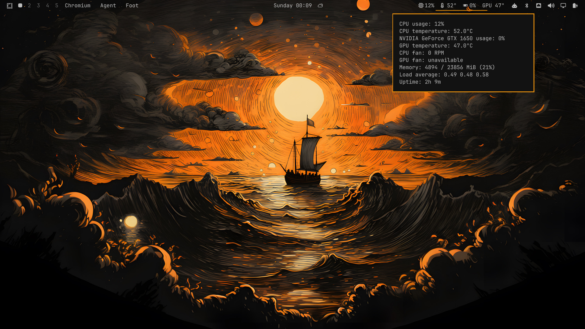

# System Monitor

An Omarchy Quickshell bar widget for CPU and GPU activity and temperatures. Hover over the widget for memory use, fan speeds (when exposed by the kernel or NVIDIA tools), load average, and uptime.



## Features

- CPU usage, with a CPU/package temperature when a suitable sensor is available
- GPU utilization and temperature through `nvidia-smi` or Linux DRM sysfs interfaces
- Tooltip with memory use, CPU/GPU fan readings, load average, and uptime
- Updates every three seconds
- Python 3 standard library only; no Python packages or root privileges required

GPU utilization and fan data depend on driver/kernel support. On NVIDIA, install the driver utilities that provide `nvidia-smi`. On AMD and Intel, the driver may expose `gpu_busy_percent` and sensor data under `/sys/class/drm`. Missing readings are reported as unavailable. Nerd Font glyphs are used in the bar text.

## Install

On a current Omarchy installation with shell plugin support:

```sh
omarchy plugin add https://github.com/al-araf-git/System-Monitor-Arch-Linux-Omarchy.git
```

The plugin ID is `endmin.system-monitor`. Omarchy installs the repository under `~/.config/omarchy/plugins/endmin.system-monitor/`. Restart or reload the shell/bar if the widget does not appear, then add **System Monitor** to the bar through the shell's bar widget controls.

For manual development, clone or copy the repository to:

```text
~/.config/omarchy/plugins/endmin.system-monitor/
```

The manifest and `BarWidget.qml` must remain at the plugin root. The QML entry point launches `monitor.py` with `/usr/bin/python3` and expects that path in the plugin directory.

## Development and validation

Edit the plugin in its installed directory; Omarchy watches plugin files and reloads changes. Validate the manifest and QML using the tooling available in your Omarchy version:

```sh
omarchy plugin validate ~/.config/omarchy/plugins/endmin.system-monitor
qmllint ~/.config/omarchy/plugins/endmin.system-monitor/BarWidget.qml
```

Some Omarchy versions may not expose `omarchy plugin validate`; `omarchy plugin add` performs manifest validation during installation. QML linting requires the Omarchy/Quickshell imports to be available to `qmllint`.

## Plugin metadata

- ID: `endmin.system-monitor`
- Kind: `bar-widget`
- Entry point: `BarWidget.qml`
- Manifest schema: 1

## License

MIT. See [LICENSE](LICENSE).
